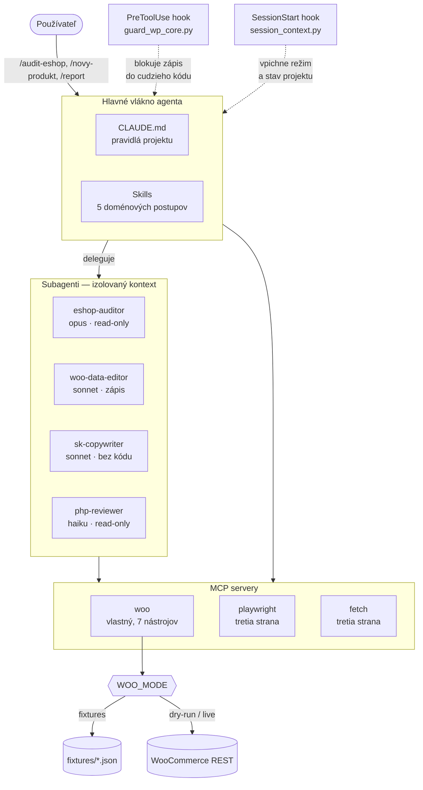

# Architektúra setupu

## Ako to do seba zapadá

## Prečo takto

### Skills nesú znalosť, nie kód

Skill je postup, ktorý by inak bolo treba diktovať pri každej úlohe. Každý z piatich
skillov zodpovedá práci, ktorá sa v praxi opakuje a má vlastné pasce — zlučovanie
variantov, nonce vo WordPresse, `$e.run` v Elementore, zákon 108/2024, formát
odovzdávky pre klienta.

Hlavný `SKILL.md` je krátky. Detaily sú v `references/` a načítajú sa až keď ich agent
naozaj potrebuje. Tabuľka nastavení Elementor widgetov má zmysel v momente, keď sa
widget vkladá — nie v každej relácii.

### Subagenti chránia kontext aj dáta

Dva dôvody, prečo nie všetko v hlavnom vlákne:

1. **Kontext.** Výpis katalógu alebo audit celého e-shopu zaberie tisíce tokenov,
   ktoré hlavné vlákno po dokončení úlohy nepotrebuje. Subagent ich spracuje
   a vráti zhrnutie.
2. **Práva.** `eshop-auditor` a `php-reviewer` nemajú jediný zápisový nástroj.
   Nejde o inštrukciu, ktorú môže model obísť — nástroje im nie sú dané.

Model je zvolený podľa náročnosti: `haiku` na mechanickú kontrolu snippetu,
`opus` na audit, kde treba posúdiť dopad.

### MCP server je vlastný, nie generický

Univerzálny HTTP MCP server by na WooCommerce REST stačil. Vlastný server rieši tri
veci, ktoré generický nevie:

| | Generický HTTP MCP | `woo` |
|---|---|---|
| Veľkosť odpovede | celý objekt, 60+ polí na produkt | 8 polí, zvyšok na vyžiadanie |
| Bezpečnosť zápisu | zapíše, čo dostane | tri režimy, mimo `live` iba náhľad |
| Doménová logika | žiadna | `audit_seo` vrátane kontroly diakritiky |

### Hooky riešia to, čo inštrukcia neuchráni

Pravidlo „needituj cudzí plugin" je v `CLAUDE.md`, ale inštrukcia je len text.
`guard_wp_core.py` je kontrola, ktorá beží pred každým zápisom a vráti zamietnutie
s vysvetlením, kam zmena patrí namiesto toho.

`session_context.py` rieši opačný problém: agent na začiatku relácie nevie, či beží
nad demo dátami alebo nad ostrým e-shopom. Hook mu to povie skôr, než sa spýta.

## Rozdelenie zodpovedností

| Vrstva | Súbor | Čo rieši |
|---|---|---|
| Pravidlá | `CLAUDE.md` | jazyk, prostredie, čo sa nesmie |
| Postupy | `.claude/skills/*/SKILL.md` | ako sa robí konkrétna práca |
| Izolácia | `.claude/agents/*.md` | kto má aké nástroje a model |
| Vstupné body | `.claude/commands/*.md` | čo používateľ napíše |
| Vynútenie | `.claude/settings.json` + `hooks/` | čo sa nedá obísť |
| Dáta | `.mcp.json` + `mcp-servers/woo-mcp/` | prístup k e-shopu |
